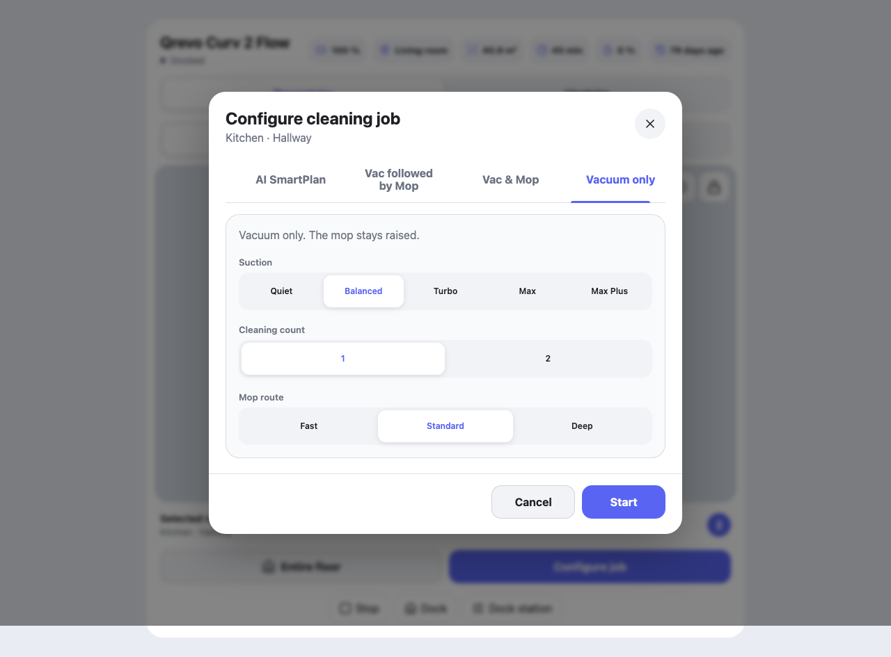
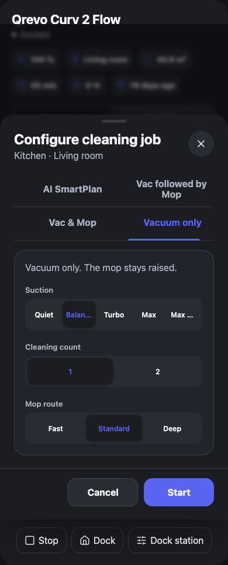
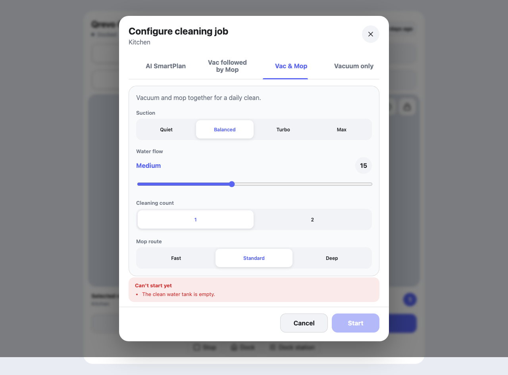
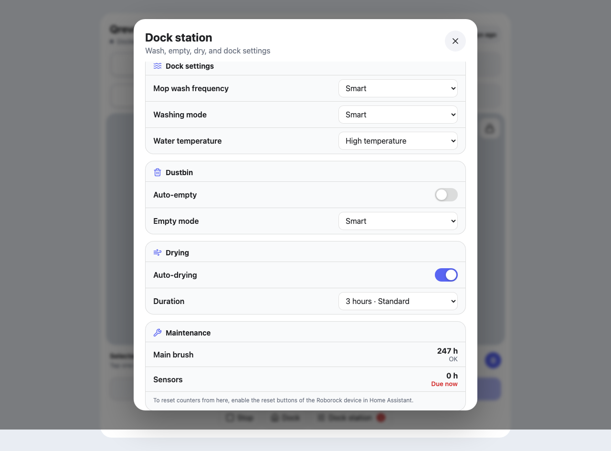
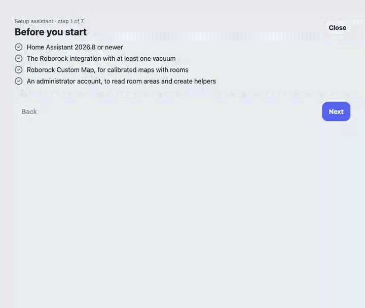

<div align="center">

# Roborock Vacuum Map Card

**Clean exactly the rooms you want, the way the Roborock app does it, right from your Home Assistant dashboard.**

[](https://hacs.xyz/docs/faq/custom_repositories/)
[](https://github.com/domidyon/roborock-vacuum-map-card/releases)
[](https://github.com/domidyon/roborock-vacuum-map-card/actions/workflows/ci.yml)
[](https://www.home-assistant.io/integrations/roborock/)
[](LICENSE)

[](https://my.home-assistant.io/redirect/hacs_repository/?owner=domidyon&repository=roborock-vacuum-map-card&category=plugin)



</div>

> [!NOTE]
> **A hobby project, shared as-is.** I build this card for my own home, mostly
> with the help of AI coding assistants, for fun. Some people found the repo and
> started using it, so I've tried to make it useful for others too. Expect
> rough edges, no support guarantees, and features shaped by my own Roborock
> setup. Issues and pull requests are welcome, and I'll look at them when I can.

---

## Why this card?

Most vacuum cards give you a map and a Start button. This card behaves like the
Roborock app: tap rooms or draw a zone, pick a mode, tune suction, water and
route, and the card sends the job through Home Assistant's **official Roborock
integration**. There's no cloud bridge, no custom component, and nothing that
guesses room boundaries.

## ✨ Highlights

| | |
|---|---|
| 🗺️ **Real maps** | Calibrated Roborock maps with zoom, pan, room labels and accessible SVG room overlays |
| 🏠 **Room & floor jobs** | Multi-room selection, *Entire floor* with per-room exclusions, and multi-floor homes with automatic map switching |
| ▭ **Zone cleaning** | Draw, move and resize rectangles for Vacuum, Mop, or Vac & Mop jobs |
| 🧠 **App-style modes** | SmartPlan, Vac followed by Mop (native routines), Vac & Mop, Vacuum, and opt-in Mop only |
| 🎚️ **Only what your robot supports** | Suction, water flow, passes and mop routes are detected live from your entities. Internal Roborock modes stay hidden |
| 🧽 **Dock control** | Empty, wash, dry, wash frequency/mode/temperature, auto-empty, drying duration, child lock, with confirmation before anything noisy |
| 🪜 **Assisted carry** | A guided, reload-safe workflow for cleaning a floor that has no dock |
| 🛡️ **Safe by design** | Settings stay a draft until you press Start. Every option is validated against live entities, and a failed step aborts before cleaning |
| 🚰 **Pre-start checks** *(beta)* | An empty clean-water tank or a detached mop blocks a mop job; a full dirty tank, a dock error or low battery gets a warning first |
| 🧹 **Maintenance** *(beta)* | Brush, filter, sensor and strainer life in the dock panel, a badge when something is due, and resets with confirmation |
| 📱 **Feels native** | Mobile bottom sheet, desktop dialog, light and dark themes, keyboard support |
| 🌍 **Translated** | English, Nederlands, Polski, Türkçe ([add yours](#-translations)) |
| 🧩 **Visual editor** | Setup assistant, Re-detect, sections, Home Assistant's own pickers, lossless YAML round-tripping |
| 🩹 **Diagnostics** | One click copies a redacted report for bug and model reports |

<table>
  <tr>
    <td></td>
    <td><br>
        </td>
  </tr>
</table>

## 🤖 Supported robots

The card works with any Roborock vacuum that the official Home Assistant
integration supports. Features adapt to the entities your model exposes.

| Model | Status | Notes |
|---|---|---|
| Qrevo Curv 2 Flow | ✅ Tested daily | Full dock, multi-floor, assisted carry |
| Saros 10R | 🟢 Community | Mop only supported (`enable_mop_only: true`) |
| S7 / S7+ | 🟡 Experimental | Profile included on beta, awaiting hardware confirmation ([#2](https://github.com/domidyon/roborock-vacuum-map-card/issues/2)) |
| Others | ❔ Probably works | [Send a model report](https://github.com/domidyon/roborock-vacuum-map-card/issues/new?template=model_report.yml) |

See [supported models](docs/models.md) for what each model profile changes.

## 📋 Requirements

- **Home Assistant 2026.8** or newer (for native `vacuum.clean_area` and the Roborock *Cleaning mode* select)
- The official **[Roborock integration](https://www.home-assistant.io/integrations/roborock/)**, with map segments mapped to Home Assistant areas
- **[Roborock Custom Map](https://github.com/Python-roborock/RoborockCustomMap)**, which provides the calibrated map images with room data
- [HACS](https://hacs.xyz) (recommended)

## 📦 Installation

### HACS (recommended)

1. Click the **Open in HACS** button above, or in HACS go to **⋮ → Custom repositories**,
   add `https://github.com/domidyon/roborock-vacuum-map-card`, and choose **Dashboard**.
2. Install **Roborock Vacuum Map Card**.
3. Reload your browser when HACS asks.

### Manual

1. Download `roborock-vacuum-map-card.js` from the [latest release](https://github.com/domidyon/roborock-vacuum-map-card/releases/latest).
2. Copy it to `/config/www/`.
3. Under **Settings → Dashboards → ⋮ → Resources**, add `/local/roborock-vacuum-map-card.js` as a **JavaScript module**.

## 🚀 Quick start

1. Edit a dashboard → **Add card** → **Roborock Vacuum Map Card**.
2. The card starts with your vacuum, maps, rooms and areas already filled in. Open the
   editor and the **setup assistant** *(beta)* walks you through checking them: floors,
   rooms, dock helpers and a default mode.
3. Save, tap a room, and press **Start**.

Changed something in Home Assistant later? **Re-detect** in the editor offers the fixes
(new rooms, renamed maps, deleted areas) one by one.

<p align="center"></p>

A minimal YAML config looks like this:

```yaml
type: custom:roborock-vacuum-map-card
entity: vacuum.roborock_qrevo
entities:
  cleaning_mode: select.roborock_qrevo_cleaning_mode
  mop_mode: select.roborock_qrevo_mop_mode
  mop_intensity: select.roborock_qrevo_mop_intensity
floors:
  - id: home
    name: Home
    map_entity: image.roborock_qrevo_home_custom
    rooms:
      - { segment_id: 16, area_id: kitchen, name: Kitchen, icon: mdi:countertop }
      - { segment_id: 17, area_id: living_room, name: Living room, icon: mdi:sofa }
```

📖 **Full option list, multi-floor setup, dock helpers, assisted carry and service
behavior are documented in the [configuration reference](docs/configuration.md).**

## 🔧 How it works

When you press **Start**, the card:

1. Checks every chosen option against the live options of your entities.
2. Switches to the right floor and confirms the switch, if needed.
3. Applies the cleaning mode, then suction, water flow, route and pass count.
4. Starts one native job: `vacuum.start` for a full floor, `vacuum.clean_area` for
   selected rooms, or `roborock.set_vacuum_zoned_cleaning` for zones.

If any step is rejected, the card stops, keeps your draft, and tells you which step
failed. It never rolls back or improvises. Details are in
[Service behavior](docs/configuration.md#service-behavior).

## 🩺 Troubleshooting

| Symptom | Fix |
|---|---|
| "Calibration/rooms missing" | Select the `…_custom` image from Roborock Custom Map, and reload that integration after the Roborock integration has loaded |
| A room is greyed out | Assign it a Home Assistant area in the editor, and map that segment in the Roborock entity settings |
| Vacuum only / Mop only unavailable | Configure the *Cleaning mode* select (HA 2026.8+). For Mop only, also set `enable_mop_only: true` |
| Floor switch times out | Make `map_select_option` exactly match an option of your selected-map entity |
| Card not found after install | Hard-refresh the browser and check the resource is loaded as a JavaScript module |

More answers are in the [troubleshooting guide](docs/troubleshooting.md) and the [FAQ](docs/faq.md).
Reporting a bug? Use **Copy diagnostics** in the card editor and paste the result.

## 🗺️ Roadmap

The road to **1.0** is all about setup that just works:

- ✅ On the beta branch now: setup assistant, Re-detect, model profiles and a model catalog,
  one-click dock helpers, presets as scripts, pre-start checks and maintenance
- 🧰 Native dock entities instead of helpers, once Home Assistant's fixes ship and they pass every check
- 🩹 **Diagnostics export** for quick, useful bug reports

Work happens on the [`beta`](https://github.com/domidyon/roborock-vacuum-map-card/tree/beta)
branch. See the [CHANGELOG](CHANGELOG.md) for what has already shipped.

## 🤝 Contributing

Bug reports, model reports and pull requests are very welcome. This is a
spare-time project, so please be patient with responses. See
[CONTRIBUTING](CONTRIBUTING.md) for the development setup and pull-request checklist,
and the [Code of Conduct](CODE_OF_CONDUCT.md). Security issues: see [SECURITY](SECURITY.md).

### 🌍 Translations

The card and the editor are translated into English, Nederlands, Polski and Türkçe.
[docs/translating.md](docs/translating.md) explains how to add or improve a language.
Thanks to everyone who contributed Turkish and Polish!

### 📚 Documentation

[Configuration](docs/configuration.md) · [Supported models](docs/models.md) ·
[Troubleshooting](docs/troubleshooting.md) · [FAQ](docs/faq.md) · [Translating](docs/translating.md)

## 🙏 Credits

Selected interaction and presentation patterns were adapted from the MIT-licensed
[Dreame Vacuum Map Card](https://github.com/noambergauz/dreame-vacuum-map-card).
See [NOTICE](NOTICE) for exact attribution. Map data is provided by
[Roborock Custom Map](https://github.com/Python-roborock/RoborockCustomMap) and
the [python-roborock](https://github.com/Python-roborock/python-roborock) project.

*Roborock is a trademark of Beijing Roborock Technology Co., Ltd. This is an
unofficial community project and is not affiliated with or endorsed by Roborock.*

## 📄 License

[MIT](LICENSE) © [domidyon](https://github.com/domidyon)
